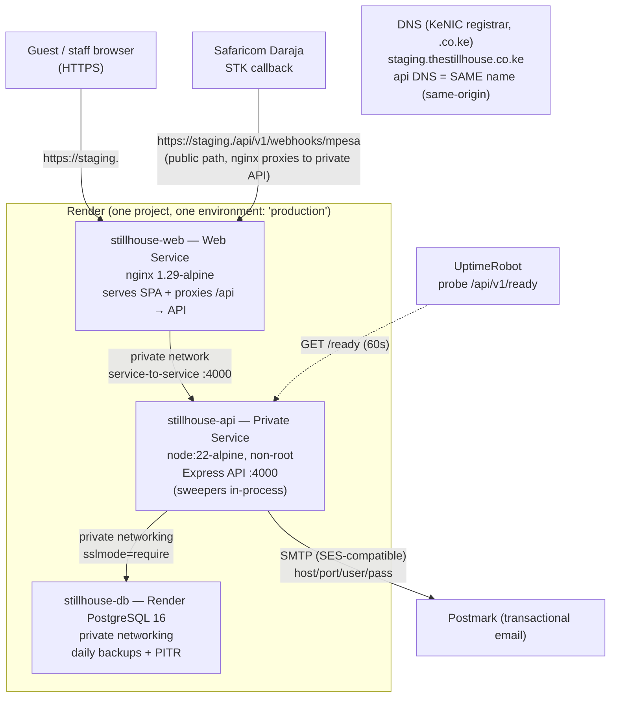

# THE STILLHOUSE — Phase 1 Deployment Blueprint (Render)

**Prepared:** 2026-11-12 · **Baseline commit:** `cee2a11` (main, in sync) · **Status:** PROPOSED — blueprint only; nothing provisioned, nothing purchased.

Evidence-backed plan for deploying the existing stack (React/Vite SPA + Express/Prisma API + PostgreSQL 16) to Render with a `.co.ke` domain, Postmark email and UptimeRobot monitoring. **Architecture is preserved: same-origin SPA, nginx in front, private API, no new frontend, no new backend.**

## 1. Architecture (Mermaid)

**Correct frontend-to-API routing:** unchanged from today — SPA calls **same-origin** `/api/v1/*` (`apps/web/src/services/api.js`, `VITE_API_BASE_URL` override optional, default `/api/v1`), nginx proxies `/api/` to the API service. The API can remain **unreachable from the public internet**; the only public entry is nginx on the same `.co.ke` origin. Daraja's callback hits the public nginx, which proxies it to the private API.

## 2. Component inventory

| Component | Image/tool | Source | Notes |
|---|---|---|---|
| Web (SPA + TLS + /api proxy) | `apps/web/Dockerfile`, nginx 1.29-alpine, `NGINX_CONF=nginx.conf` | repo | public Web Service; `/healthz` internal probe; serves the SPA build from `dist/` |
| API | `apps/api/Dockerfile`, node:22-alpine, non-root `:4000` | repo | private service; `/api/v1/ready` for Render healthcheck |
| Database | Render PostgreSQL 16 (Private networking) | provider | non-DDL app role; PITR; daily backups |
| Migrations | `prisma/migrations/*` via `node node_modules/prisma/build/index.js migrate deploy` (container CMD pattern; **npx removed from image**) | repo | run BEFORE API rollover (CI deploy step already does this pattern; `docker-compose.staging.yml` `migrate` service is the reference) |
| Secrets | Render environment variables (secret files) / GH Actions `STAGING_*` (for CI-driven deploy) | provider | names only in repo |
| TLS | Render-managed (auto at edge + on custom domain) | provider | HSTS remains in nginx vhost |
| Email | Postmark | provider | SMTP `EMAIL_SMTP_*` |
| Uptime | UptimeRobot | provider | probe `https://staging.<domain>/api/v1/ready` |

**Integration/sharing with local staging:** topology mirrors the local `stillhouse-staging` compose project (web→proxy→api→db, private network, same image, same vhost). No behavioral change.

## 3. Database deployment plan

1. **Provision (owner-authorized):** Render PostgreSQL 16 — smallest paid plan that satisfies boot load (validate with owner): suggested starting tier `0.5c-1g` (100 connections default — fine with app pool `max:10`). Disable scale-to-zero analogs; single AZ; PITR enabled (Hobby workspace: 3-day window; Pro: 7-day — pick per budget).
2. **Roles:** Render creates the primary credentials. Create a **non-DDL app role** (`CREATE ROLE app LOGIN`; `GRANT CONNECT, USAGE, SELECT/INSERT/UPDATE/DELETE` on public schema + sequences; **no** `CREATE`) via a one-off psql run. Production app uses that role; NEVER the owner/superuser.
3. **TLS:** service connects with `sslmode=require` (Render PG serves SSL on 5432 internally + externally). Verification: app `/ready` returns `db:up` via SSL.
4. **Migration order:** `migrate deploy` FIRST (CI/deploy job already sequences this), then roll API, then web. Additive-only; no data migration today.
5. **Pool:** app pool `max:10`; total concurrent API+worker ≈ 12 — well below 100-connection default.
6. **Initial production DB prep:** catalogue-only seed (`prisma/seed.js`) with explicit `SEED_*_PASSWORD` envs; **zero reservations**; staff users via `SEED_*`; verify `room_allocation_no_overlap` via `\d room_allocation` after migrate (same file path as local), and exhaustion test = already passed locally.
7. **Backups:** Render daily backups + PITR window (verify it's actually enabled in dashboard **before Gate D** — untested backup is not a backup). Weekly `pg_dump` to object storage optional (R2/S3-class, ~$0.02/GB/mo, ~small).
8. **PITR restore procedure (staging + prod):** Render dashboard → Database → Backups → restore to a **new scratch database** → verify counts (`room`=28, `reservation`≥0, `room_allocation_no_overlap` present) → boot API against scratch via a one-off Render command → walk guest journey → drop scratch. Log in `docs/BACKUP_RESTORE.md`.
9. **Rollback with additive migrations:** app rollback = previous image tag; no DB reversal ever (D-055). Destructive migration = restore from backup + migrate deploy.

**Initial-production safety:** `node prisma/seed.js` with `SEED_ADMIN_EMAIL` + explicit `SEED_ADMIN_PASSWORD`; dev fixture users NEVER seeded; reservations table empty at launch.

## 4. Deployment and rollback sequence (with recovery)

After Leon authorizes Phase 1 (Gate A sign-off pre-work; **not yet**):

1. Provision Render project `thestillhouse` + environment `production` (or `staging` first if Leon prefers rehearsal there).
2. Declare secrets: `DATABASE_URL=postgresql://app:***@<private-host>/stillhouse?sslmode=require`, `SESSION_SECRET`, `WEB_ORIGIN=https://staging.thestillhouse.co.ke`, `COOKIE_SECURE=true`, `TRUST_PROXY=1`, `NODE_ENV=production`, `MPESA_*` (disabled), `EMAIL_SMTP_*` (Postmark), `ADMIN_NOTIFICATION_EMAIL`.
3. Verify private DB connectivity (Render one-off command: `psql $DATABASE_URL -c 'select 1'`).
4. Build images locally or let Render build from Dockerfile (`docker build -f apps/api/Dockerfile .`), push via GHCR (preferred) or let Render build (needs repo access — Leon's choice; keep GHCR path from `.github/workflows/ci.yml`).
5. Apply `migrate deploy` from a CI job / one-off private command (same image, same command as staging compose).
6. Deploy API (private service). Health check path `/api/v1/ready` → 200 with `db:up`.
7. Deploy web (public service). Health check `/healthz` → 200.
8. Custom domain `staging.thestillhouse.co.ke` → `stillhouse-web`; TLS auto (Render); HSTS via nginx vhost (already set).
9. Public acceptance: `tests/staging-acceptance.mjs` 16/16 **against the public URL** (archive `staging-acceptance-public-<date>.json`).
10. Backup drill on Render (restore to scratch).
11. **Rollback drill:** deploy explicit previous image tag (e.g. tag before this release) → re-run smoke 16/16 → restore previous tag forward again (or leave prior tag deployed). Record timings.

**If migration succeeds but the app fails:** previous image keeps serving IF the staged deploy decoupled migrate from app (our deploy does: migrate → app rollover). Worst case: migrate applied → app rollback redeploys old image; old code reads new columns (additive; old code ignores unknown tables/columns) → no data loss; fix forward, or restore-from-backup only if migrate corrupted data (not expected — additive only). Never run `migrate` manually against prod without a pre-migration backup reference.

## 5. Security checklist (hard requirements, all already in the codebase)

- Secrets in Render env (secret files / env groups) — never in git, docs, logs; rotation = redeploy (SESSION_SECRET is a boot-time guard only — it is not used to sign sessions, so rotating it does not invalidate existing sessions).
- HTTPS enforced at edge (Render) + HSTS at nginx; redirect HTTP→HTTPS (Render handles; nginx keeps its own).
- Cookies `Secure; HttpOnly; SameSite=Lax` (boot-required).
- CSP: `default-src 'self'`; upgrade `img-src` after photography commissioned.
- `TRUST_PROXY=1` matches one Render edge hop.
- `COOKIE_SECURE=true` + `NODE_ENV=production` boot guard: process exits otherwise (verified M6/M7).
- Rate limits active (300/15min global, 10/15min auth); webhook route bypasses limiter but enforces amount+reference match + terminal-state idempotency.
- Non-DDL app role; no public DB port; PITR backups; no demo fixtures in prod; `SEED_*` required for staff users.
- Daraja callback allowlist (`MPESA_WEBHOOK_ALLOWED_IPS`) optionally set once Safaricom publishes production IPs; logs redact refs/emails; audit log append-only.
- nginx security headers (nosniff, DENY, Referrer-Policy, Permissions-Policy, CSP, HSTS) — unchanged from repo.

## 6. CI/CD design

Reuse `.github/workflows/ci.yml` unchanged as the verify gate. Add a **deploy** job (staging: `workflow_dispatch` + `STAGING_DEPLOY_ENABLED=true`; production: separate manual workflow or same with `PRODUCTION_DEPLOY_ENABLED`) that:

1. checks out tag `vX.Y.Z`,
2. runs Verify (audit/tests/e2e/images/Trivy) as today,
3. builds + pushes `ghcr.io/...:vX.Y.Z` (both images),
4. SSH/deploy-hooks to Render (Render Deploy Hook URL — owner creates; stored as GH secret `RENDER_DEPLOY_HOOK`) OR `render blueprint sync + deploy` via Render CLI (Render's documented pattern; no server creds in repo),
5. runs `migrate deploy` as a Render **one-off job** triggered by the pipeline BEFORE web rollover,
6. polls `/ready` (3 min), then runs public smoke (`staging-acceptance.mjs` against public URL),
7. on failure: Render rollbacks via prior deploy (Render retains N deploys; instant rollback button) + incident note.

**No automatic production deployment from `main`.** Production deploy = manual trigger + explicit tag + `PRODUCTION_DEPLOY_ENABLED=true` + owner's go-ahead. Migration-before-rollover preserved. Image scanning (Trivy) stays.

## 7. Cost & operational considerations (per `docs/COMMISSIONING.md` §9)

| Item | Recurring | Notes |
|---|---|---|
| Render workspace Hobby ($0) or Pro ($25) | $0 or $25/mo | Pro if you want 7d PITR + 14d logs + rollback history |
| Web service (1c-2g) | $25/mo | or 0.5c-512MB $7/mo if Leon accepts lighter spec |
| PostgreSQL (0.5c-1g) | $19/mo | PITR included in plan tier |
| Custom domain (.co.ke) | ~KSh 1,500/yr | registrar-dependent |
| Postmark Basic | $15/mo | 10k emails included |
| UptimeRobot Free | $0 | 50 monitors, 5-min |
| Render egress included (Hobby 5GB) | $0 initially | watch >5GB → $0.15/GB over |
| Optional offsite pg_dump | ~$0/mo | R2-class storage, trivial |
| **Estimated total** | **≈ US$59/mo (Hobby) ≈ KES 7,700** | or ≈ US$84/mo (Pro) ≈ KES 10,900; FX ≈ 129.97 |

**Scaling triggers:** API CPU >70% sustained → step to 1c-2g→2g; API memory >80% → bump tier; PG connections >60 → review pool sizing (not scale instance blindly); 5xx-rate alert → investigate before scaling.
**Op responsibilities:** Leon (billing, DNS, secrets rotation, launch call); deployment and verification per this blueprint. No on-call contract exists — UptimeRobot pages whoever Leon names.

## 8. Owner actions vs deployment actions

**Leon (and only Leon):** approve Render project creation; enter secret values into Render env (this document never sees them); create Render Postgres; register `staging.<domain>` in KeNIC registrar + set DNS at registrar; approve custom domain; flip `STAGING_DEPLOY_ENABLED=true`; create Deploy Hook in Render; choose Postmark plan; decide workspace Hobby vs Pro; verify restore drill result; authorize first public cutover; hold Daraja credentials.
**Deployment session:** all configs (vhost paths if needed, `render.yaml` if owner wants IaC later — not required), deploys, migrate job, acceptance suite runs, drills, security scans, documentation, issue fixes, verification reports against the **public** URL (never localhost-only).

## 9. Risks and unresolved decisions

1. **Render private hostname format for service-to-service** — verify in dashboard/docs at provisioning. Fallback (zero code change): point nginx at the API's public `onrender.com` URL; SPA remains same-origin as far as the guest/browser is concerned. Either satisfies same-origin + CSP.
2. **Render PG PITR window depth** — 3d (Hobby) vs 7d (Pro) — Leon's cost call.
3. **Daraja callback via nginx** — the callback logs will show nginx's headers; the API currently records `req.ip` as socket address (Render edge IP), not the real caller — **documented; do not attempt to fix unless Safaricom requires true-IP logging** (would need `X-Forwarded-For` trust — acceptable because TRUST_PROXY=1, but defer).
4. **No Render account exists** — provisioning absolutely gated on Leon's explicit Phase 1 authorization (Gate A pre-work approval).
5. **Render Free tier** — NOT used for production (512MB, 100 connections, no SLA) — explicitly rejected.
6. **Image size**: API image ≈ 160MB, web ≈ 25MB (verified M6) — cold start acceptable.
7. **AWS RDS alternative rejected** (ops burden, no pricing quoted); **Neon rejected** for this plan (Render PG simpler, same org, private network); **Fly.io rejected** (no Africa region, PITR weaker, egress to Kenya $0.12/GB); **Self-hosted VPS PG rejected** (D-050).
8. **docker-compose.prod.yml** still references `npx prisma migrate deploy` semantics? — checked: M6 already fixed to `node node_modules/prisma/build/index.js migrate deploy`. No change needed.
9. **CI `ci.yml` staging job references `docker-compose.staging.yml` on the host** — for Render, the host doesn't hold compose; the Render Blueprint path (build via Render + deploy hook) replaces SSH-pull. **Decision deferred to owner's preference** between (a) Render-native build (simpler; repo must be Render-connected; no SSH secrets), (b) GHCR images + Render deploy hook (images pre-built in CI; no source exposure in Render). (a) is fewer moving parts; (b) is more auditable. **Default: (a), recorded as PROPOSED in §7/§5.**

## 10. Acceptance criteria for Phase 1 completion (Gate A)

- Public staging URL serves the SPA over HTTPS with a valid chain; HTTP→HTTPS 301.
- `GET /api/v1/ready` → `{"ok":true,"db":"up"}` publicly; `/healthz` → 200 on web.
- `tests/staging-acceptance.mjs` → 16/16 **against the public URL**; archived evidence file.
- Managed PG restore drill logged (scratch restored + counts + exclusion constraint + scratch dropped).
- Rollback drill logged (≤30 min; smoke 16/16 after rollback).
- Backup age alert active; UptimeRobot shows green for 15 minutes straight; Leon receives a test page.
- No P0/P1 security regressions (headers, CSP, HSTS, cookie flags, RBAC matrix) re-verified against the public URL.

## 11. Repository changes required (if any) — minimal

- `docs/COMMISSIONING.md`: §0.1 references this blueprint (done below).
- **No application code changes anticipated.** If Render private networking cannot satisfy vhost proxy semantics, the only change would be `apps/web/nginx.conf` `proxy_pass` target — a one-line vhost edit, behind Leon's approval, rebuilt as a new tag.
- `.github/workflows/ci.yml`: optional Phase 1 add-on `deploy-review` job — NOT required for Gate A; Render's native Git-connected deploys suffice.
- New: this blueprint (`docs/PHASE_1_DEPLOYMENT_BLUEPRINT.md`). Nothing else.

— **STOP CONDITION MET** — This document is a proposal. Provision nothing until Leon approves.
